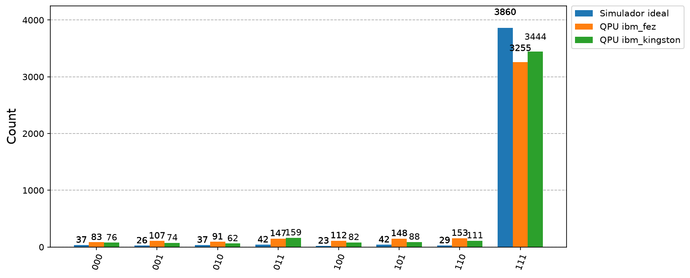

# Práctica de Laboratorio No. 3: Algoritmo de Grover para Búsqueda Cuántica

**Universidad de Antioquia** · Maestría en Ingeniería · Asignatura: **Computación Cuántica** (2026)

**Autores:** Carlos Andres Duran Paredes y Juan David Zapata Londoño

## Objetivo

Analizar e implementar una versión modular del algoritmo de Grover en Qiskit, entender su funcionamiento y la importancia del número de iteraciones,
y ejecutarlo tanto en simulador como en un procesador cuántico real de IBM.

El algoritmo de Grover encuentra un elemento marcado en un conjunto no ordenado de $N = 2^n$ elementos con $O(\sqrt N)$ consultas al oracle, frente a
las $O(N)$ de una búsqueda clásica.

> **Alcance de este repositorio.** Contiene las actividades **2 a 8** de la práctica. La actividad 1 (análisis matemático a mano del circuito de 2 qubits)
> la desarrolló Juan David Zapata Londoño y se publica por separado; aquí solo se usan sus resultados como referencia en las comparaciones de la actividad 2.

Material de referencia: el tutorial de IBM Quantum Learning
[*Grover's algorithm*](https://quantum.cloud.ibm.com/learning/en/courses/utility-scale-quantum-computing/grovers-algorithm)
y el notebook del curso [`N-Grover_AnyMark_2026.ipynb`](https://github.com/gpatigno/QC_POSGRADO_2026/blob/main/LAB/PR3/N-Grover_AnyMark_2026.ipynb).

## Estructura

```
qiskit-grover-udea/
├── README.md
├── requirements.txt
├── notebooks/
│   ├── Actividad2_N_Grover_2qubits.ipynb       # notebook del curso ejecutado con 2 qubits
│   ├── Actividad2_Comparacion_Tutorial.ipynb   # comparación con el tutorial de IBM y con el análisis manual
│   ├── Actividad3_Grover_Modular.ipynb         # circuito en bloques (Figura 1)
│   ├── Actividad4_Iteraciones.ipynb            # k automático y 3 qubits vs. tutorial
│   ├── Actividad5_Experimentos.ipynb           # n = 4, 5, 6 (y un caso con 2 estados marcados)
│   ├── Actividad6_Codigo_Documentado.ipynb     # justificación matemática de cada bloque
│   └── Actividad7_8_QPU_Real.ipynb             # ejecución en ibm_fez e ibm_kingston y reporte
├── docs/
│   ├── Actividad2_Comparaciones.pdf            # documento de comparaciones de la actividad 2
│   ├── Actividad2_Comparaciones.tex
│   └── generar_figuras_actividad2.py           # genera las figuras del documento
├── figuras/                                    # figuras generadas por los notebooks y el script
└── resultados/
    ├── experimentos_simulacion.csv             # resumen de la actividad 5
    ├── distribuciones_simulacion.csv           # distribución completa de cada experimento de la actividad 5
    └── resultados_qpu.csv                      # conteos de los QPU y de los simuladores (actividades 7 y 8)
```

## Actividades

| # | Actividad | Notebook / documento |
|---|---|---|
| 2 | **Extensión para $n$ qubits (10 %).** Ejecución del notebook N-Grover del curso con 2 qubits; comparación con el tutorial de IBM y con el análisis manual. | `Actividad2_N_Grover_2qubits.ipynb`, `Actividad2_Comparacion_Tutorial.ipynb`, `docs/Actividad2_Comparaciones.pdf` |
| 3 | **Modularización (20 %).** Bloques `Inicializacion`, `Oracle`, `Difusor`, `OperadorGrover`, `Medicion` y `Grover`, contrastados con la Figura 1 del enunciado. | `Actividad3_Grover_Modular.ipynb` |
| 4 | **Iteraciones (10 %).** `Iteraciones(n, M)` calcula $k = \lfloor \frac{\pi}{4}\sqrt{N/M} \rfloor$ con manejo de casos límite; simulación con 3 qubits y comparación con el tutorial. | `Actividad4_Iteraciones.ipynb` |
| 5 | **Experimentos (20 %).** $n = 4, 5, 6$: estado marcado, iteraciones, distribución final, probabilidad de éxito y conteos. | `Actividad5_Experimentos.ipynb` |
| 6 | **Documentación (10 %).** Comentarios en español; demostración del cambio de fase del Oracle, de la inversión sobre la media $2\lvert\psi\rangle\langle\psi\rvert - I$ y del número de iteraciones, con comprobación numérica. | `Actividad6_Codigo_Documentado.ipynb` |
| 7–8 | **Hardware real (10 %) y resultados.** Ejecución en QPU de IBM de 156 qubits, reporte y comparación con simuladores ideal y con ruido. | `Actividad7_8_QPU_Real.ipynb` |

## Resumen de resultados

**Actividad 2 ($n = 2$, estado `01`).** N-Grover da `{'01': 1024}` y estado final $-\lvert 01\rangle$; el tutorial da `{'001': 1024}` (el dígito extra es su qubit auxiliar).
El oracle y el difusor de ambos son las mismas matrices sobre los qubits de datos, y los estados de cada etapa coinciden con el análisis manual.
Como el tutorial usa 3 qubits y N-Grover 2, la comparación de estados se hace sobre los qubits de datos ($\lvert\Psi_\text{tutorial}\rangle = \lvert 0\rangle_\text{aux}\otimes\lvert\psi_\text{N-Grover}\rangle$).

**Actividad 4 ($n = 3$, estado `111`).** $k = 2$, igual que el tutorial. Probabilidad de éxito teórica 0.9453, medida 0.948 (tutorial: 0.954).
Con 3 y 4 iteraciones baja a ≈ 0.33 y ≈ 0.01, como en el tutorial.

**Actividad 5 (simulador, 1024 disparos).**

| $n$ | $N$ | Estado(s) marcado(s) | $k$ | $P$ éxito teórica | $P$ éxito medida |
|---|---|---|---|---|---|
| 4 | 16 | `1010` | 3 | 0.9613 | 0.9609 |
| 5 | 32 | `10110` | 4 | 0.9992 | 1.0000 |
| 6 | 64 | `110010` | 6 | 0.9966 | 0.9961 |
| 5 | 32 | `00111`, `11001` | 3 | 0.9613 | 0.9580 |

**Actividades 7 y 8 (hardware real, $n = 3$, estado `111`, $k = 2$, 4096 disparos).**

| QPU | Job ID | Qubits físicos del QPU | $P$ éxito QPU | Simulador con ruido | Simulador ideal |
|---|---|---|---|---|---|
| `ibm_fez` | `dbmeatt8mdtc73d7qpc0` | 156 | 0.7947 | 0.8496 | 0.9424 |
| `ibm_kingston` | `dbmdvgt8ft8s738umv00` | 156 | 0.8408 | 0.8613 | 0.9424 |



## Tecnologías

Python 3.13 · Qiskit 2.5.2 · Qiskit Aer 0.18.2 · Qiskit IBM Runtime 0.51.0 · NumPy · Matplotlib · Jupyter. Versiones exactas probadas en `requirements.txt`.

## Instalación

```bash
python -m venv .venv
source .venv/bin/activate        # Windows: .venv\Scripts\activate
pip install -r requirements.txt
```

En Google Colab basta ejecutar las celdas `!pip install ...` del inicio de cada notebook.

## Ejecución

```bash
jupyter lab notebooks/
```

- Los notebooks se ejecutan desde la carpeta `notebooks/` (guardan figuras en `../figuras` y tablas en `../resultados`).
- Los simuladores usan `seed_simulator=2026`, así que los conteos se repiten en cada ejecución.
- El notebook de las actividades 7 y 8 necesita una cuenta de IBM Quantum. Las credenciales **no** están en el repositorio: se guardan una vez con
  `QiskitRuntimeService.save_account(...)` (la celda correspondiente está comentada y con valores de ejemplo). Por defecto el notebook **recupera** los dos
  trabajos ya ejecutados por su Job ID; con `JOBS = None` envía un trabajo nuevo al QPU menos ocupado con al menos 127 qubits.
- Las figuras del documento de la actividad 2 se regeneran con `cd docs && python generar_figuras_actividad2.py`.

## Limitaciones

- **Ruido en hardware real.** En los QPU la probabilidad de éxito baja de 0.94 (simulador ideal) a 0.79–0.84. El circuito de 3 qubits queda con 39 compuertas CZ
  y profundidad 152 al transpilarlo. Los trabajos se ejecutaron con las opciones por defecto del Sampler, sin desacoplamiento dinámico ni mitigación de errores
  de lectura; no se probaron esas opciones para no gastar más tiempo de QPU.
- **Modelo de ruido.** El simulador con ruido usa la calibración vigente cuando se ejecuta el notebook, no la del momento en que corrieron los trabajos.
- **Tamaño del problema en hardware.** La Z multicontrolada crece rápido en compuertas de dos qubits con $n$; en el hardware actual conviene usar pocos qubits.
- **Comparación con el tutorial.** El tutorial usa un qubit auxiliar y otras semillas de muestreo; los conteos solo se comparan dentro de la variación estadística.
- **Aviso de versión.** `qiskit-ibm-runtime` 0.51 marca `SamplerV2` como obsoleto (aviso visible en `Actividad2_Comparacion_Tutorial.ipynb`); el código funciona,
  pero en versiones futuras puede requerir el nuevo `Sampler`.
